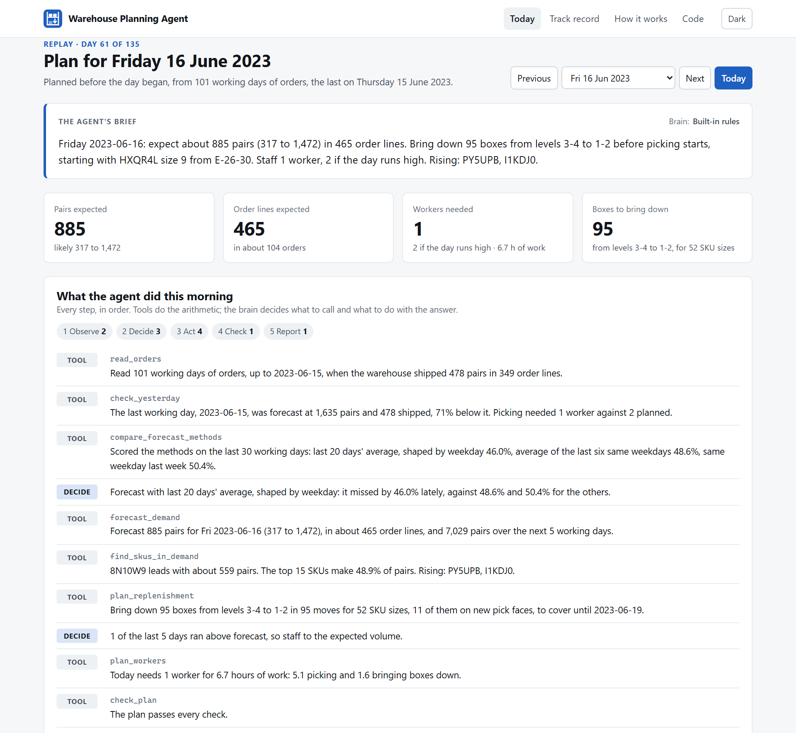

<div align="center">

<br>

<a href="https://shreyasthakur11.github.io/warehouse-planning-agent/" title="Warehouse Planning Agent: an AI agent that plans a warehouse's day">
  
</a>

# Warehouse Planning Agent

**An AI agent that plans a footwear warehouse's day, every morning.**

<br>

It forecasts demand, finds the SKUs in demand, brings stock down from levels 3-4 to
levels 1-2, and sets how many workers each day needs. Every step it takes is shown on
a live dashboard.

<br>

[](LICENSE)
[](https://github.com/ShreyasThakur11/warehouse-planning-agent/actions/workflows/ci.yml)
[](https://github.com/ShreyasThakur11/warehouse-planning-agent/actions/workflows/site.yml)
[](https://github.com/ShreyasThakur11)

[**Open the dashboard**](https://shreyasthakur11.github.io/warehouse-planning-agent/) &nbsp;·&nbsp;
[**Run it**](#run-it) &nbsp;·&nbsp;
[**How it works**](docs/HOW_IT_WORKS.md)

[**Read the guide (PDF)**](deliverables/Warehouse_Planning_Agent_Guide.pdf)

<br>

<a href="https://shreyasthakur11.github.io/warehouse-planning-agent/" title="Open the dashboard">
  
</a>

<br>

</div>

<br>

---

<br>

**Jump to:**
[What it plans](#what-it-plans) ·
[Why it is an agent](#why-it-is-an-agent) ·
[The live dashboard](#the-live-dashboard) ·
[How well it plans](#how-well-it-plans) ·
[Run it](#run-it) ·
[Documents](#documents) ·
[Verification](#verification)

<br>

## What it plans

Every morning, before picking starts, the agent answers four questions.

| Question | What the agent does |
|---|---|
| **How much will ship?** | Scores three forecasting methods on the last 30 working days, uses the one that missed least, and gives a likely range. |
| **Which SKUs are in demand?** | Splits the forecast across SKUs by their recent share, with each SKU's trend and the boxes it has on each level. |
| **What should come down from levels 3-4?** | Lists every box to bring down to levels 1-2, nearest first, so levels 1-2 hold enough for the next 2 working days. |
| **How many workers does each day need?** | Turns the forecast and the boxes to move into hours of work, then into workers, for the next 5 working days. |

Levels 1-2 are within a picker's reach. Levels 3-4 hold reserve stock. A SKU that sells
needs boxes on levels 1-2 before the day starts, and the agent says which ones.

<br>

## Why it is an agent

- **It runs a loop on its own.** Observe, decide, act, check, report, every morning,
  with no one at the keyboard.
- **It makes decisions.** Which forecasting method to trust today, whether to staff for
  a high day, and what to raise with the supervisor.
- **It uses tools.** Eight small tools do every sum. The agent chooses which to call and
  what to do with each answer.
- **It checks its own work.** A plan that needs more workers than the roster, or demand
  the racks cannot cover, goes to a person instead of being settled alone.
- **It can run on Claude.** With an Anthropic API key, Claude runs the loop through the
  same tools. Its brief is rejected if it states a number no tool produced.

<br>

## The live dashboard

The records end on 19 October 2023, so the dashboard replays them. Each calendar day it
shows the next working day's plan, made only from the orders before that day, exactly
as on the morning itself.

- **Today** shows the agent's brief, every step it took, the demand forecast, the SKUs
  in demand, the boxes to bring down and the workers for each day.
- **Track record** checks every plan against what the warehouse actually shipped and
  needed.
- **How it works** explains the loop, the tools and every number the agent uses.

Pick any day to see its plan and how it compared with what happened.

<br>

## How well it plans

Across 134 working days, each planned from earlier orders only:

| Measure | Result |
|---|---:|
| Forecast miss, as a share of pairs shipped | 64.9% (the same weekday last week: 75.9%) |
| Days inside the likely range | 76.1% |
| Days with enough workers planned | 79.9% (94.8% when staffed for a high day) |
| Boxes brought down that were needed in time | 27.9% |

**Where it is weak.** Daily volume swings hard in these records, so a forecast misses by
a lot even when it beats the simplest rule. Demand for one SKU in one size is lumpier
still: of the 12,610 boxes the plans brought down, 3,514 were needed within the two days
they were meant to cover, and they caught 21.6% of the boxes that truly had to come
down. The agent publishes these results rather than hiding them. See the
[evaluation](docs/EVALUATION.md).

> [!NOTE]
> The records are real and come from a footwear manufacturer's warehouse in Sherbrooke,
> Canada. They hold one snapshot of what sat where, so every morning starts from the
> same stock position. No live warehouse is connected.

<br>

## Run it

Each block is one step. No API key is required.

**1. Get the code**

```bash
git clone https://github.com/ShreyasThakur11/warehouse-planning-agent.git
```

```bash
cd warehouse-planning-agent
```

**2. Create an environment**

Windows:

```bash
python -m venv .venv
```

```bash
.venv\Scripts\activate
```

macOS or Linux:

```bash
python3 -m venv .venv
```

```bash
source .venv/bin/activate
```

**3. Install**

```bash
pip install -e .
```

**4. Plan the next working day, step by step**

```bash
warehouse-planner plan
```

**5. Plan any day in the records**

```bash
warehouse-planner plan --date 2023-06-16
```

**6. Replay every day and score the plans**

```bash
warehouse-planner replay
```

**7. Build the dashboard into `_site/`**

```bash
warehouse-planner site
```

To let Claude run the morning, install `pip install -e ".[claude]"` and set
`ANTHROPIC_API_KEY`. See [`.env.example`](.env.example).

<br>

## Documents

| Read this | To learn |
|---|---|
| [Guide (PDF)](deliverables/Warehouse_Planning_Agent_Guide.pdf) | How to read one real plan, part by part, and how far to trust each part |
| [Slides](deliverables/Warehouse_Planning_Agent_Deck.pptx) | A ten-minute talk on the project, with speaker notes |
| [Poster (PDF)](deliverables/Warehouse_Planning_Agent_Poster.pdf) | The whole project on one A1 sheet |
| [User guide](docs/USER_GUIDE.md) | How to read the dashboard and use the agent |
| [How it works](docs/HOW_IT_WORKS.md) | The loop, the tools, the two brains and the guard |
| [Data](docs/DATA.md) | The records, and how the agent reads them |
| [Evaluation](docs/EVALUATION.md) | Every score, including what does not work well |

The guide, the slides and the poster are built from the replay's evidence and the built
dashboard by [`scripts/documents/build.mjs`](scripts/documents/build.mjs), so every figure
in them matches the site.

<br>

## Verification

CI runs on every push and holds the project to its own claims:

- The tests cover the records' hashes, the forecast, the replenishment rules, the worker
  count, the agent's loop, the number guard and the replay.
- A real browser opens every page of the built dashboard and checks it does its job.
- Every figure in this file and in `docs/` must trace to the replay's output, under the
  same check the language model answers to.

<br>

## License

Code under the [MIT License](LICENSE). The [dataset](https://doi.org/10.17632/pf2w725pw3.1)
is CC BY 4.0, credited in [NOTICE](NOTICE).
